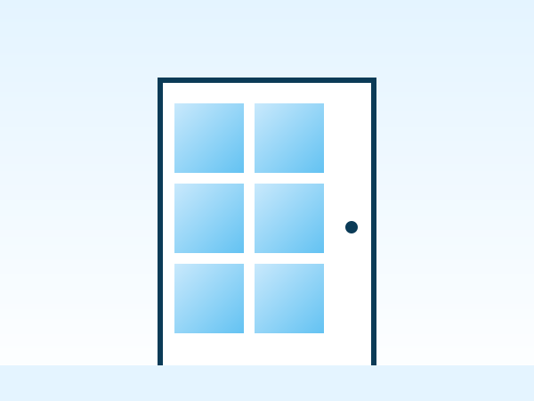

# TMV - SARL — Site vitrine

Site web vitrine statique pour **Tafotien Métallique et Vitrages (TMV-SARL)**, entreprise de métallerie et de vitrage basée à Kalaban Koro, Bamako, Mali.

Site 100 % HTML / CSS / JavaScript — **aucun backend, aucune base de données**.

---

## 1. Lancer le site

**Option A — directement dans le navigateur**
Double-cliquez sur `index.html`.

**Option B — avec Visual Studio Code (recommandé)**
1. Ouvrez le dossier `TMV-SARL` dans VS Code.
2. Installez l'extension **Live Server**.
3. Clic droit sur `index.html` → **Open with Live Server**.

---

## 2. Structure du projet

```
TMV-SARL/
├── index.html          Page d'accueil
├── a-propos.html        Présentation, histoire, mission, vision, valeurs
├── services.html        Détail de tous les services
├── realisations.html    Galerie filtrable + modal
├── equipe.html           Équipe et direction
├── contact.html          Coordonnées + formulaire + carte
├── css/style.css        Toute la feuille de style (design system)
├── js/script.js         Toutes les fonctionnalités JavaScript
├── images/               Dossiers d'images (voir section 3)
└── README.md
```

Le site utilise dès maintenant de **vraies images** : un jeu d'illustrations originales (`images/illustrations/*.svg`), dans le style bleu ciel du site, représentant les façades, portes, garde-corps, escaliers, vitrages et membres d'équipe. Elles permettent de présenter un site complet et cohérent dès l'ouverture, en attendant les vraies photos de l'entreprise.

---

## 3. Remplacer les illustrations par vos propres photos

1. Placez vos photos dans le dossier correspondant :
   - `images/logo/` → logo de l'entreprise
   - `images/accueil/` → photos de la page d'accueil (hero, présentation)
   - `images/services/` → une photo par service
   - `images/realisations/` → photos de chaque réalisation
   - `images/equipe/` → photos des membres de l'équipe

2. Dans le HTML, chaque visuel est un cadre `.ph-image` contenant une balise ``. Il suffit de changer le `src` (et l'`alt`) pour pointer vers votre vraie photo. Exemple :

   **Avant (illustration fournie) :**
   ```html
   <div class="ph-image" style="--ar:4/3;">
     
   </div>
   ```

   **Après (votre photo) :**
   ```html
   <div class="ph-image" style="--ar:4/3;">
     
   </div>
   ```
   Le cadre `.ph-image` gère déjà les coins arrondis et le recadrage (`object-fit: cover`) — aucune autre modification CSS n'est nécessaire.

3. Pour la galerie (`realisations.html`), chaque vignette possède aussi un attribut `data-image="images/illustrations/..."` utilisé par la modal (aperçu en grand) : mettez-le à jour avec le même chemin que celui utilisé dans la balise `` de la vignette.

4. Pour le **logo** dans le header et le footer, remplacez :
   ```html
   <span class="brand-mark">TMV</span>
   ```
   par :
   ```html
   
   ```

---

## 4. Modifier les coordonnées (téléphone, WhatsApp, horaires, adresse)

### Téléphone
Recherchez `Téléphone à ajouter` et `tel:#` dans les fichiers HTML (footer et `contact.html`) et remplacez par le vrai numéro, exemple : `tel:+22370000000`.

### WhatsApp
Ouvrez `js/script.js` et modifiez la première ligne utile :
```javascript
const whatsappNumber = "NUMERO_A_AJOUTER";
```
Remplacez par le numéro complet, **au format international, sans "+" ni espaces**, exemple :
```javascript
const whatsappNumber = "22370000000";
```
Ce numéro est utilisé automatiquement par : le bouton WhatsApp flottant, le formulaire de devis, et les liens WhatsApp de la page Contact.

### Email
L'adresse `tmvsarl@gmail.com` est déjà configurée (formulaire de contact, footer, page Contact). Pour la changer, modifiez la constante `contactEmail` dans `js/script.js` ainsi que les occurrences `tmvsarl@gmail.com` dans les fichiers HTML.

### Horaires et adresse exacte
Recherchez « horaires à préciser » dans `contact.html` et remplacez par les vrais horaires. L'adresse (`Kalaban Koro, Bamako, Mali`) est déjà en place ; précisez-la si vous disposez d'une adresse plus exacte (rue, repère).

### Réseaux sociaux
Dans le footer de chaque page, remplacez les `href="#"` des icônes Facebook / Instagram / LinkedIn / WhatsApp par vos vrais liens.

---

## 5. Ajouter une nouvelle réalisation

Dans `realisations.html`, dupliquez un bloc `.gallery-item` et modifiez son contenu :

```html
<div class="gallery-item" data-category="vitrage" data-category-label="Vitrage" data-title="Titre de la réalisation" data-image="images/realisations/ma-photo.jpg">
  <div class="ph-image">
    
    <div class="gallery-caption"><strong>Titre de la réalisation</strong><span>Vitrage</span></div>
  </div>
</div>
```
L'attribut `data-image` doit pointer vers le même fichier que la balise `` : il est utilisé pour afficher la photo en grand dans la modal.

- `data-category` doit correspondre à l'un des filtres existants : `metallerie`, `portes`, `escaliers`, `garde-corps`, `vitrage`, `baies-vitrees`, `vitrines` (ou un nouveau filtre, voir ci-dessous).
- Remplacez ensuite le bloc `.ph-image` par une vraie image (voir section 3).

**Ajouter une nouvelle catégorie de filtre** : ajoutez un bouton dans `.filters` :
```html
<button class="filter-btn" data-filter="ma-categorie">Ma catégorie</button>
```

---

## 6. Modifier les services

Les services apparaissent à deux endroits :
- `index.html` (section « Nos services », aperçu en cartes)
- `services.html` (page complète, une section détaillée par service)

Pour modifier un service existant, changez simplement le texte, le titre ou l'icône (classe `bi bi-...`, voir [Bootstrap Icons](https://icons.getbootstrap.com/)) dans les deux fichiers.

Pour ajouter un nouveau service, dupliquez une carte dans `index.html` et un bloc `.split` dans `services.html`, puis ajoutez le lien correspondant dans le footer si besoin.

---

## 7. Modifier les membres de l'équipe

Dans `equipe.html`, dupliquez une `.card.team-card` :

```html
<div class="card team-card">
  <div class="ph-image"><span class="ph-tag">Photo à ajouter</span><span class="ph-label">Nom du membre</span></div>
  <h3>Nom du membre</h3>
  <p class="role">Fonction</p>
  <p>Courte description du rôle de ce membre.</p>
</div>
```

Les cartes « À compléter » sont des emplacements réservés à remplacer par les vrais membres de l'équipe.

---

## 8. Modifier l'historique de l'entreprise

Le contenu de la section « Notre histoire » (`a-propos.html`) est **temporaire** — les dates et événements réels n'ont pas encore été fournis. Recherchez le bloc `<div class="timeline">` et remplacez le contenu par l'historique réel de TMV-SARL dès qu'il sera disponible.

---

## 9. Vérifications effectuées

- Tous les liens de navigation et du footer pointent vers des pages existantes.
- Le menu mobile (hamburger) fonctionne sur toutes les pages.
- Le bouton WhatsApp flottant et le formulaire de devis génèrent un lien `wa.me` avec message pré-rempli.
- Le formulaire de contact génère un lien `mailto:` avec message pré-rempli.
- La galerie dispose d'un filtre par catégorie et d'une modal d'affichage en grand (navigation clavier : flèches, Échap).
- Le site est responsive (testé sur les tailles 1920×1080, 1366×768, 768×1024, 390×844).
- Textes alternatifs, labels de formulaire et contrastes ont été pris en compte pour l'accessibilité.

---

## 10. Technologies utilisées

- HTML5 / CSS3 / JavaScript (aucun framework)
- Palette graphique : bleu ciel et blanc (variables CSS modifiables en tête de `css/style.css`)
- [Bootstrap Icons](https://icons.getbootstrap.com/) (CDN)
- Polices [Space Grotesk](https://fonts.google.com/specimen/Space+Grotesk) et [Work Sans](https://fonts.google.com/specimen/Work+Sans) (Google Fonts, CDN)
- Aucune base de données, aucun système de connexion, aucun paiement en ligne.

© 2026 TMV - SARL. Tous droits réservés.
